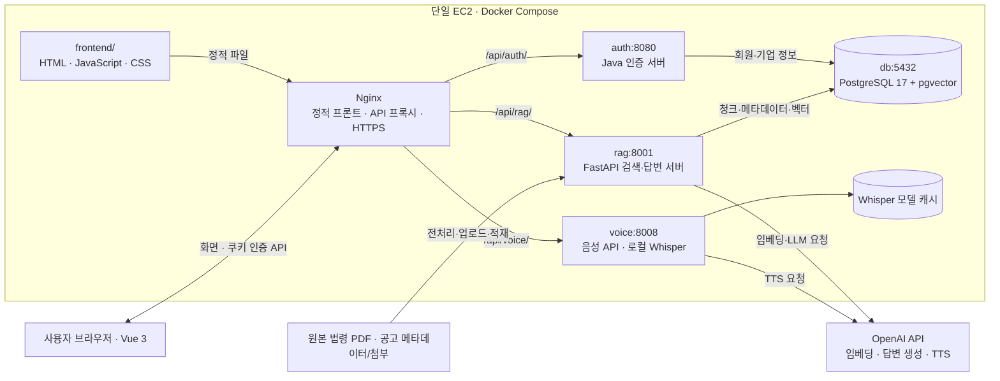

# 경영지원 AI — ai_mini_project

기업의 상시근로자 수와 기업 유형을 바탕으로 **노무 법령·지원사업 공고를 검색하고, 근거와 함께 답변하는 RAG 웹 애플리케이션**입니다. 텍스트·음성 질문을 지원하며 생성된 답변을 음성으로 들을 수 있습니다.

RAG는 질문과 관련된 자료를 먼저 검색하고, 그 근거를 언어 모델에 전달해 답변을 생성하는 방식입니다.

이 문서는 현재 저장소의 **통합 Docker Compose 실행 경로**를 기준으로 설명합니다. 검색 저장소는 PostgreSQL/pgvector입니다. 일부 파일에 남아 있는 FAISS·MariaDB·독립 통번역 데모 설명과 구분해야 합니다.

## 목차

1. [주요 기능](#1-주요-기능)
2. [전체 아키텍처](#2-전체-아키텍처)
3. [프로젝트 디렉터리](#3-프로젝트-디렉터리)
4. [구성별 메인 기능과 핵심 코드](#4-구성별-메인-기능과-핵심-코드)
5. [주요 처리 흐름](#5-주요-처리-흐름)
6. [API와 데이터 저장 구조](#6-api와-데이터-저장-구조)
7. [환경변수와 실행](#7-환경변수와-실행)
8. [검증 방법과 현재 상태](#8-검증-방법과-현재-상태)
9. [관련 문서와 후속 작업](#9-관련-문서와-후속-작업)

## 1. 주요 기능

| 기능 | 설명 |
|---|---|
| 회원가입·로그인 | 계정·상시근로자 수·기업 유형을 등록하고 JWT 쿠키로 인증 |
| 경영지원 상담 | 법령 PDF에서 관련 조항·부칙을 검색하고 출처를 포함한 답변 생성 |
| 사업공고 상담 | 적재된 공고에서 관련 내용을 검색하고 기업 유형·접수 상태를 반영 |
| 자료 관리 | 자료 준비 상태 확인, 일반 법령 PDF 업로드, 관리 자료의 변경 제한 안내 |
| 음성 질문 | 최대 60초 녹음 → 로컬 STT → 문장 확인·수정 → 기존 RAG 검색 |
| 답변 듣기 | 요청 시 TTS API로 표시된 답변을 음성으로 변환해 재생 |
| 근거·검토 안내 | 출처, 적용한 기업 정보, 근거 부족·전문가 검토 필요 여부 표시 |

사업공고의 `source="web"`은 **DB에 수집·적재한 공고 검색**을 의미합니다. 질문할 때마다 인터넷 전체를 검색하는 기능은 아닙니다.

## 2. 전체 아키텍처

### 2.1 서비스 연결



### 2.2 배포 단위

| 서비스 | 기술·실행 진입점 | 메인 역할 | 내부 포트 |
|---|---|---|---|
| `nginx` | Nginx, [공통 라우팅](deploy/nginx/app.conf) | 정적 프론트 제공, API 분기, 공개 배포 시 TLS 종료 | `80`, 공개 설정에서 `443` |
| `auth` | JDK HttpServer, [`SimpleAuthServer.main()`](workplace/app/src/main/java/workplace/SimpleAuthServer.java) | 회원가입·로그인·로그아웃, BCrypt, JWT | `8080` |
| `rag` | Python 3.11/FastAPI, [`rag_external-web_pdf_closed_llm:app`](rag-code-template_ext/rag_external-web_pdf_closed_llm.py) | 자료 적재, 검색, 기업 정보 반영, 답변 생성 | `8001` |
| `voice` | Python 3.11/FastAPI, [`app.voice_api:app`](voice-ai_code/app/voice_api.py) | 로컬 STT, 외부 TTS 호출 | `8008` |
| `db` | PostgreSQL 17 + pgvector | 회원·검색 데이터를 테이블·컬렉션으로 구분해 저장 | `5432` |

기본 배포는 Nginx만 호스트의 `127.0.0.1:8080`에 연결합니다. [공개 HTTPS 설정](compose.public.yaml)은 Nginx의 80/443을 추가 공개합니다. 인증·RAG·음성·DB는 Docker 내부 네트워크로 연결합니다.

컨테이너가 다섯 개라는 것은 **같은 EC2에서 프로그램 다섯 개를 실행**한다는 뜻입니다. 음성 기능에 별도 EC2를 만드는 구성은 아닙니다. 단일 인스턴스로 충분한지는 로컬 Whisper를 포함한 CPU·메모리 사용량을 측정해야 합니다.

## 3. 프로젝트 디렉터리

```text
ai_mini_project/
├── compose.yaml                    # 통합 서비스·볼륨 구성
├── compose.public.yaml             # 공개 HTTPS용 추가 설정
├── .env.example                    # 환경변수 예시
├── frontend/                       # 현재 사용자용 Vue 정적 프론트
│   ├── index.html                  # 가입·로그인·상담·자료 관리 템플릿
│   ├── assets/app.js               # 화면 상태와 API 연결
│   ├── assets/voice.js             # 녹음·취소·음성 재생 관리
│   ├── assets/styles.css           # 공통 UI·반응형 스타일
│   └── tests/voice.test.cjs
├── workplace/                      # Java 인증 서버·회원 스키마
│   ├── app/src/main/java/workplace/SimpleAuthServer.java
│   └── sql/init.sql
├── rag-code-template_ext/          # RAG API·저장소·자료 파이프라인
│   ├── rag_external-web_pdf_closed_llm.py
│   ├── rag_answer.py               # 프롬프트·출처·검토 판단
│   ├── rag_meta.py                 # 업로드 청킹·공고 메타데이터
│   ├── core/                      # JWT·pgvector 저장소·SQL
│   ├── law_pipeline/              # 법령 전처리·적재·검색·평가
│   ├── tools/                     # 공고 수집·변환·업로드 도구
│   ├── data/                      # 출처 목록·메타데이터·처리 결과
│   ├── eval/                      # 평가셋·답변 평가·실험 기록
│   └── tests/                     # 저장소·API·이관 테스트
├── voice-ai_code/                  # 음성 API·기존 통번역 데모
│   ├── app/voice_api.py            # 통합 배포의 음성 진입점
│   ├── app/auth.py                 # 음성 API JWT 검증
│   ├── app/services/               # STT·TTS·기존 번역 서비스
│   ├── app/main.py                 # 기존 독립 통번역 데모
│   ├── Dockerfile.voice            # 통합 음성 서버 이미지
│   └── tests/test_voice_api.py
├── upload-paper/                   # 원본 법령 PDF 11개
├── deploy/                         # Nginx·DB 초기화·배포·통합 검증
├── docs/                           # 작업 이력·음성 설계·다음 작업
└── eval.sh                         # RAG 답변 평가 실행 도우미
```

루트의 `intro_main.html`, `external_index.html`, `internal_index.html`과 음성 프로젝트의 `app/static/`에는 이전 실습·개발 화면이 남아 있습니다. 현재 사용자 화면은 **`frontend/`와 `/chat` 경로**를 기준으로 봅니다.

## 4. 구성별 메인 기능과 핵심 코드

아래 예시는 현재 구현의 핵심 부분입니다. 독립 실행 스크립트가 아니며 전체 검증·오류 처리는 연결된 원본 코드에서 확인할 수 있습니다.

### 4.1 프론트엔드 — 사용자 입력과 API 연결

별도 Node 서버 없이 Nginx가 HTML·Vue 런타임·JS·CSS를 제공합니다. 브라우저의 Vue가 현재 경로에 따라 같은 템플릿으로 네 화면을 구성합니다.

| 화면 | 메인 기능 |
|---|---|
| `/signup` | 계정·비밀번호 확인·상시근로자 수·기업 유형 등록 |
| `/login` | 로그인, 오류·세션 만료 안내 |
| `/chat` | 분야 선택, 텍스트/음성 질문, 답변·출처·기업 정보, 답변 듣기 |
| `/documents` | 자료 상태, PDF 등록·결과, 관리 자료 제한 안내 |

**핵심 코드:** [템플릿](frontend/index.html), [`app.js`](frontend/assets/app.js)의 `initialize()`, `api()`, `ask()`, `listen()`, [`voice.js`](frontend/assets/voice.js)의 `VoiceChat.create()`.

`ask()`는 입력 방식과 관계없이 최종 질문을 기존 RAG API로 전달합니다.

```javascript
this.answer = await this.api('/api/rag/rag-query', {
  method: 'POST',
  headers: { 'Content-Type': 'application/json' },
  body: JSON.stringify({
    prompt: this.submittedQuestion,
    source: this.source,
    top_k: 5,
  }),
});
```

`api()`는 쿠키를 포함해 요청하고 인증 만료 시 로그인으로 이동합니다. JWT를 localStorage에 저장하지 않습니다. 음성 컨트롤러는 마이크 권한·녹음·취소·늦게 도착한 응답·오디오 Blob URL을 관리합니다.

### 4.2 인증 서버 — 계정·기업 정보·JWT

Spring Boot가 아닌 **JDK HttpServer** 기반입니다. HTTP 처리부, `AuthService`, `JdbcUserRepository`, `JwtUtil`이 현재 하나의 Java 파일에 들어 있습니다. 소스 호환성은 Java 17, Docker 빌드·런타임은 JDK/JRE 21입니다.

| 핵심 코드 | 역할 |
|---|---|
| [`SimpleAuthServer.java`](workplace/app/src/main/java/workplace/SimpleAuthServer.java)의 `main()` | HTTP 핸들러 등록 |
| 같은 파일의 `AuthService.signUp()`, `login()` | BCrypt 해시 생성·비밀번호 검증 |
| 같은 파일의 `JdbcUserRepository` | PreparedStatement로 회원·기업 정보 조회·저장 |
| 같은 파일의 `JwtUtil.createToken()`, `verifyToken()` | 기업 정보와 1시간 만료를 가진 JWT 발급·검증 |
| [`core/auth.py`](rag-code-template_ext/core/auth.py), [`app/auth.py`](voice-ai_code/app/auth.py) | RAG·음성 서버에서 동일 JWT 검증 |

비밀번호 처리의 핵심은 다음과 같습니다.

```java
String hashed = BCrypt.hashpw(rawPassword, BCrypt.gensalt(12));
boolean ok = BCrypt.checkpw(rawPassword, u.getPassword());
```

로그인 시 `ACCESS_TOKEN`을 HttpOnly·SameSite=Lax 쿠키로 발급합니다. JWT에는 `sub`, `username`, `employees`, `companyTypes` 등이 들어가며, RAG는 이를 답변에 반영할 기업 정보로 사용합니다. 공개 HTTPS Nginx 설정이 쿠키에 Secure 속성을 추가합니다.

RAG는 토큰을 읽을 때 서명·알고리즘·발급자를 검증합니다.

```python
payload = jwt.decode(
    token,
    _get_secret(),
    algorithms=[JWT_ALGORITHM],
    issuer=JWT_ISSUER,
)
```

Compose가 인증·RAG·음성 서버에 **동일한 `JWT_SECRET`**을 주입합니다. Java에는 기존 메모리 세션도 남아 있지만 RAG·음성 API 보호는 JWT를 기준으로 합니다.

### 4.3 RAG 서버 — 검색과 근거 기반 답변

[`rag_external-web_pdf_closed_llm.py`](rag-code-template_ext/rag_external-web_pdf_closed_llm.py)의 `rag_query()`가 검색과 생성을 조합합니다. 현재 두 분야의 답변 생성 모델은 코드상 `gpt-4o`입니다.

| 분야 | 처리 방식 |
|---|---|
| `pdf` / 경영지원 | 법령 검색 → 조항·관련 부칙 문맥 → 기업 정보 반영 → 답변·인용 출처·검토 안내 |
| `web` / 사업공고 | 공고 검색 → 기업 유형이 맞는 후보 우선 배치 → 접수 상태를 포함한 문맥 → 답변·공고 출처 |

법령 검색 결과를 답변 문맥으로 연결하는 핵심 부분입니다.

```python
retrieval = search_law_pipeline(vectorstore, rewritten or rag_request.prompt, top_k)
docs_scores = [
    (Document(page_content=h["text"], metadata=h["metadata"]), h["score"])
    for h in retrieval["hits"]
]
context = build_law_context(docs_scores)
supplementary = "\n\n".join(r["text"] for r in retrieval["supplementary_context"])
if supplementary:
    context += "\n\n[관련 부칙·적용례]\n" + supplementary[:6000]
```

이후 `build_law_prompt()`에 원래 질문·문맥·기업 정보를 넣고 LLM을 호출합니다.

```python
full_prompt = build_law_prompt(rag_request.prompt, context, persona)
raw = llm.invoke([HumanMessage(content=full_prompt)]).content
```

문맥이 없거나 생성 결과가 근거 부족을 나타내면 `자료에서 찾을 수 없음`으로 응답하고 출처를 비웁니다. 답변이 있으면 출처를 추리고 필요 시 전문가 확인 안내를 붙입니다.

**핵심 코드:** [`rag_answer.py`](rag-code-template_ext/rag_answer.py)의 `expand_query()`, `build_law_prompt()`, `judge_needs_review()`, `cited_sources()`, `rank_notices_for_persona()`, `build_notice_prompt()`, `notice_sources()`.

현재 API의 검색어 확장은 규칙 기반 동의어 확장입니다. 파일에 남아 있는 이전 실험용 LLM 질문 재작성 코드와 구분합니다.

### 4.4 벡터 저장소 — pgvector·BM25·RRF

[`core/vector_store.py`](rag-code-template_ext/core/vector_store.py)의 `PgVectorStore`가 저장·검색을 담당합니다.

| 메서드 | 메인 기능 |
|---|---|
| `write_vectors()` | 컬렉션·차원·청크 ID를 검증하고 트랜잭션으로 저장 |
| `add_documents()` | 업로드 문서 임베딩, 동일 `source_file` 청크 교체 |
| `retrieve()` | 질의 임베딩 → PostgreSQL 거리 검색 → 선택적으로 hybrid 순위 결합 |

의미 검색은 pgvector의 L2 거리를 제곱해 사용합니다.

```sql
SELECT content, metadata,
       power(embedding <-> %s::vector, 2) AS distance
FROM rag_chunks
WHERE collection = %s
ORDER BY distance, chunk_id
LIMIT %s;
```

[`law_pipeline/index.py`](rag-code-template_ext/law_pipeline/index.py)의 `lexical_scores()`는 단어·한글 2·3-gram으로 BM25를 계산합니다. `rank_hybrid()`가 의미 검색 순위와 어휘 검색 순위를 RRF로 합칩니다.

```python
fusion = {
    doc.metadata["chunk_id"]:
        1 / (60 + i + 1)
        + (1 / (60 + lexical_ranks[i]) if i in lexical_ranks else 0)
    for i, (doc, _) in enumerate(ranked)
}
```

`score`는 **작을수록 가까운 제곱 L2 거리**, `retrieval_score`는 **클수록 우선하는 RRF 값**입니다. 둘 다 답변 정확도의 확률은 아닙니다. 현재는 소규모 자료 대상의 정확 검색과 Python BM25이며, HNSW 같은 근사 검색 인덱스는 추가하지 않았습니다.

### 4.5 자료 파이프라인 — 원문을 검색 데이터로 변환

#### 법령 PDF

`upload-paper/`에는 노무법령 4개와 기업 지원 근거법 7개, 총 11개 원본 PDF가 있습니다. **원본 파일 복사만으로 DB 검색 데이터가 갱신되지는 않습니다.**

| 핵심 코드·자료 | 역할 |
|---|---|
| [`data/laws/sources.json`](rag-code-template_ext/data/laws/sources.json) | 법령별 출처·기준일·원본 해시 |
| [`extract.py`](rag-code-template_ext/law_pipeline/extract.py)의 `preprocess()` | 페이지 추출, 반복 문구 정리, 조항·시행일·부칙 분리, 청킹 |
| [`schema.py`](rag-code-template_ext/law_pipeline/schema.py) | 메타데이터 계약 검증·답변 출처 형식 생성 |
| [`index.py`](rag-code-template_ext/law_pipeline/index.py)의 `build_index()` | 현행 청크·기준일 검증, 임베딩 생성, pgvector 적재 |
| 같은 파일의 `search()` | 후보·출처·관련 부칙·검토 필요 여부 반환 |
| [`__main__.py`](rag-code-template_ext/law_pipeline/__main__.py) | `preprocess`, `build`, `search` CLI |

전처리는 `pages.jsonl`, `articles.jsonl`, `chunks.jsonl`, `supplements.jsonl`, 검토 목록·보고서를 만듭니다. 청크에 법령명·조항·페이지·출처 URL·기준일을 유지합니다. 파이프라인이 관리하는 컬렉션은 일반 `/upload-paper`로 바꾸려 하면 409를 반환합니다.

#### 사업공고

[`tools/`](rag-code-template_ext/tools/)의 수집·변환 도구가 기업마당 원본, 메타데이터 JSON, 첨부 PDF를 준비합니다. [`upload_notices.py`](rag-code-template_ext/tools/upload_notices.py)가 `/upload-notice` API에 적재합니다. 현재 Compose에는 자동 주기 수집 작업이 없습니다.

[`rag_meta.py`](rag-code-template_ext/rag_meta.py)의 `build_notice_chunks()`는 공고 개요·첨부 본문을 청크로 만들고, `notice_status()`는 저장된 기간·접수 방식으로 상태를 분류합니다. 같은 `notice_id`와 파일 키로 재적재하면 해당 청크를 교체합니다. 실제 조기 마감 여부는 원문 확인이 필요합니다.

### 4.6 음성 서버 — STT와 TTS

STT(Speech-to-Text)는 음성을 글로, TTS(Text-to-Speech)는 글을 음성으로 바꾸는 기능입니다.

통합 배포는 [`app/voice_api.py`](voice-ai_code/app/voice_api.py)를 사용합니다. [`app/main.py`](voice-ai_code/app/main.py)는 기존 STT → 번역 → TTS 데모이며 통합 검색의 진입점이 아닙니다.

| 기능 | 핵심 코드 | 동작 |
|---|---|---|
| 업로드·음성 인식 | `voice_api.py`의 `transcribe()` | JWT, 형식·12MiB 제한, 요청별 임시 폴더, 처리 후 삭제 |
| 변환·모델 | [`stt_service.py`](voice-ai_code/app/services/stt_service.py)의 `convert_webm_to_wav()`, `get_model()`, `transcribe_audio_file_local()` | mono/16kHz WAV 변환, 기본 `small` 모델을 CPU/int8로 지연 로드, VAD 적용 |
| 음성 합성 | `speak()`와 [`tts_service.py`](voice-ai_code/app/services/tts_service.py)의 `synthesize_speech()` | 외부 Speech API 호출 후 MP3 응답 |
| 인증 | [`app/auth.py`](voice-ai_code/app/auth.py) | 기존 Java JWT 쿠키·Bearer 검증 |

CPU 추론을 thread에서 실행하고 기본 단일 worker 안에서 STT를 한 번에 하나로 제한합니다.

```python
async with stt_slot:
    text = await run_in_threadpool(transcribe_upload, path)
```

TTS는 두 개까지 동시 호출하며 음성을 응답 본문으로 반환합니다.

```python
async with tts_slot:
    audio = await run_in_threadpool(synthesize_speech, text)
return Response(audio, media_type="audio/mpeg", headers={"Cache-Control": "no-store"})
```

현재 TTS 기본값은 `tts-1`/`nova`입니다. 녹음은 최대 60초, TTS 입력은 최대 4,096자입니다. 긴 답변은 잘라 읽지 않고 텍스트로 안내합니다. 통합 음성 API는 녹음 임시 파일을 지우고 TTS를 서버 파일로 보관하지 않습니다. 기존 독립 데모의 `/uploads` 방식과 구분합니다.

### 4.7 Nginx·Compose — 진입점과 실행 환경

[`deploy/nginx/app.conf`](deploy/nginx/app.conf)가 화면·API 경로를 분기합니다. 브라우저는 같은 도메인의 상대 경로로 요청하고 Nginx가 내부 주소·경로를 변환합니다.

```nginx
location /api/voice/ {
    client_max_body_size 13m;
    proxy_read_timeout 300s;
    rewrite ^/api/voice/(.*)$ /$1 break;
    proxy_pass $voice_backend;
}
```

`/api/voice/stt/`는 `voice:8008/stt/`로, `/api/rag/rag-query`는 `rag:8001/rag-query`로 전달됩니다. Java 가입·로그인·로그아웃은 `/api/auth/*`에서 `/api/signup`, `/api/login`, `/api/logout`으로 매핑합니다.

## 5. 주요 처리 흐름

### 5.1 로그인과 기업 정보

1. `/signup`에서 계정·기업 정보를 등록합니다.
2. Java가 비밀번호를 BCrypt로 해시해 `users`에 저장합니다.
3. `/login` 성공 시 기업 정보를 포함한 JWT 쿠키를 발급합니다.
4. 프론트가 `/api/rag/me`로 사용자·기업 정보를 확인합니다.
5. RAG·음성 API가 같은 JWT를 검증하고 요청을 처리합니다.

### 5.2 자료 준비와 검색

1. 법령 PDF를 전처리하거나 공고 메타데이터·첨부를 업로드합니다.
2. 청크·임베딩을 `pdf` 또는 `web` 컬렉션에 저장합니다.
3. 사용자가 분야와 질문을 선택합니다.
4. RAG가 질문 임베딩·의미 검색·BM25/RRF로 관련 청크를 찾습니다.
5. 기업 정보와 근거 문맥을 LLM에 전달합니다.
6. 답변·출처·검토 여부를 프론트에 표시합니다.

### 5.3 음성 질문과 답변 듣기

1. 브라우저 `MediaRecorder`로 녹음합니다.
2. `/api/voice/stt/`가 변환·Whisper 인식 후 텍스트를 반환합니다.
3. 사용자가 문장을 확인·수정하고 **답변 받기**를 누릅니다.
4. 기존 RAG 흐름으로 답변·출처를 표시합니다.
5. **답변 듣기**를 누르면 `/api/voice/tts/`가 음성을 생성합니다.
6. 브라우저가 Blob URL로 재생하고 새 검색·분야 변경·이탈 시 정리합니다.

음성 서버는 질문 입력·음성 출력을 담당합니다. 검색·기업 정보·출처 처리를 중복 구현하지 않습니다.

## 6. API와 데이터 저장 구조

### 6.1 주요 API

아래는 **Nginx를 통한 브라우저 기준 주소**입니다.

| 메서드·주소 | 주요 입력·출력 | 인증 |
|---|---|---|
| `POST /api/auth/signup` | form: `username`, `password`, `employees`, `companyTypes` | 불필요 |
| `POST /api/auth/login` | form: `username`, `password` → 로그인 쿠키 | 불필요 |
| `POST /api/auth/logout` | 세션·쿠키 정리 | 별도 JWT 선검증 없음 |
| `GET /api/auth/check` | 로그인 상태 | 세션 또는 JWT |
| `GET /api/rag/me` | 사용자와 `persona` | JWT |
| `GET /api/rag/health` | DB·분야별 자료 존재 여부 | 불필요 |
| `POST /api/rag/rag-query` | JSON: `prompt`, `source`, `top_k` | JWT |
| `POST /api/rag/upload-paper` | multipart: `file`, `category` | JWT |
| `POST /api/rag/upload-notice` | multipart: `meta` JSON 문자열, 선택 PDF `file` | JWT |
| `POST /api/voice/stt/` | multipart: `audio` → `{ "text": "인식 문장" }` | JWT |
| `POST /api/voice/tts/` | JSON: `text` → `audio/mpeg` | JWT |
| `GET /api/voice/health` | 음성 API 프로세스 생존 상태 | 불필요 |

`rag-query`의 `source`는 `pdf`/`web`, `top_k`는 1~20입니다. API 기본 `top_k`는 20, 현재 프론트는 5입니다.

| 답변 필드 | 의미 |
|---|---|
| `response` | 생성 답변 또는 근거를 찾지 못했다는 안내 |
| `sources` | 법령·조항·페이지 또는 공고명·기간·URL 등 |
| `needs_review`, `review_reason` | 검토 필요 여부·이유 |
| `persona_applied` | 반영한 상시근로자 수·기업 유형 |
| `retrieved` | 답변 생성과 별도로 남기는 검색 후보 |
| `config` | 검색·프롬프트·생성 실행 설정 |

### 6.2 DB와 영속 볼륨

| 저장 위치 | 내용 | 관련 코드 |
|---|---|---|
| `users` | 계정·BCrypt 해시·기업 유형·근로자 수 | [회원 스키마](workplace/sql/init.sql) |
| `rag_collections` | 컬렉션·임베딩 모델·차원·manifest·부칙 | [검색 스키마](rag-code-template_ext/core/pgvector.sql) |
| `rag_chunks` | 청크 ID·본문·JSONB 메타데이터·벡터 | 같은 검색 스키마 |
| `postgres_data` | PostgreSQL 데이터 파일 | [Compose](compose.yaml) |
| `law_processed` | 법령 전처리 결과 | [법령 추출 코드](rag-code-template_ext/law_pipeline/extract.py) |
| `whisper_models` | STT 모델 캐시 | [음성 서비스 설정](compose.yaml) |
| `upload-paper/` | 법령 원본, RAG에 읽기 전용 마운트 | [원본 폴더](upload-paper/) |

일반 업로드 API는 PDF를 임시 파일로 읽고 청크·메타데이터·벡터를 DB에 저장합니다. 초기 SQL은 새 DB 볼륨을 만들 때 적용되므로 기존 DB 변경은 [배포 안내](deploy/README.md)의 갱신 절차를 따릅니다.

## 7. 환경변수와 실행

### 7.1 주요 환경변수

루트 [`.env.example`](.env.example)을 기준으로 설정합니다. 실제 키·비밀번호는 커밋하지 않습니다.

| 변수 | 용도·기본값 |
|---|---|
| `POSTGRES_DB`, `POSTGRES_USER`, `POSTGRES_PASSWORD` | DB 접속 정보 |
| `JWT_SECRET` | 인증·RAG·음성 서버의 공유 서명 비밀키 |
| `OPENAI_API_KEY` | 임베딩·답변 생성·TTS 호출 |
| `EMBEDDING_MODEL`, `EMBEDDING_DIMENSIONS` | 검색 설정. 기본 모델 `text-embedding-ada-002` |
| `WHISPER_MODEL` | 로컬 STT 모델. 기본 `small` |
| `WHISPER_LANGUAGE` | 상담 STT 언어. 기본 `ko`, 기존 통번역 데모는 자동 감지 유지 |
| `VOICE_TTS_MODEL`, `VOICE_TTS_VOICE` | TTS 기본값 `tts-1`, `nova` |
| `HTTP_BIND_ADDRESS`, `HTTP_PORT` | 기본 호스트 바인딩 `127.0.0.1:8080` |

모델명은 저장소의 현재 설정입니다. 임베딩 모델·차원 변경은 기존 컬렉션과의 호환성·재적재를 검토해야 합니다. TTS 모델의 수명 주기와 전환 사항은 [음성 검색 안내](docs/VOICE_SEARCH.md)를 참고합니다.

### 7.2 로컬 또는 SSH 터널 실행

Docker Engine·Compose가 준비된 환경에서 저장소 루트를 기준으로 실행합니다.

```sh
# 최초 설정 시에만 생성하고 필수 환경변수를 채웁니다.
cp -n .env.example .env

# POSTGRES_PASSWORD, JWT_SECRET, OPENAI_API_KEY 설정 후 실행합니다.
docker compose config --quiet
docker compose up -d --build --wait
docker compose ps
```

로컬 접속은 `http://127.0.0.1:8080/chat`입니다. EC2 loopback 연결은 [SSH 터널 안내](deploy/README.md)를 따릅니다. Linux Docker 권한에 따라 `sudo`가 필요할 수 있습니다.

**서비스 기동과 자료 적재는 별개**입니다. 신규 DB에는 법령·공고를 준비해야 검색할 수 있습니다. 기본 설정으로 첫 법령 적재를 할 때의 예시입니다.

```sh
docker compose exec rag python -m law_pipeline preprocess
docker compose exec rag python -m law_pipeline build
```

기존 컬렉션이 있으면 `build`가 중단할 수 있습니다. 교체·모델 변경·백업은 [pgvector 적재·이관 안내](rag-code-template_ext/law_pipeline/PGVECTOR_MIGRATION.md)를 따릅니다. 임베딩·질의·답변·TTS에는 외부 API 사용량이 발생할 수 있습니다.

### 7.3 기존 HTTPS 서버에 반영

배포할 커밋을 서버에 반영하고 `.env`·인증서·DB 볼륨을 유지한 상태에서 실행합니다. 아래는 `compose.public.yaml`을 이미 사용하는 서버 기준입니다. 최초 인증서 발급은 [전체 배포 안내](deploy/README.md)를 따릅니다.

```sh
sudo docker compose -f compose.yaml -f compose.public.yaml up -d --build --wait
sudo docker compose -f compose.yaml -f compose.public.yaml up -d --no-deps --no-build --force-recreate --wait nginx
```

HTTPS 배포는 재기동에도 두 Compose 파일을 유지합니다. 마이크는 HTTPS 또는 localhost의 지원 브라우저가 필요합니다. 음성 기능을 처음 추가할 때는 프론트 갱신 외에 `voice` 빌드·기동도 필요합니다.

## 8. 검증 방법과 현재 상태

### 8.1 검증 코드

| 대상 | 코드 | 필요한 환경 |
|---|---|---|
| 음성 API | [`test_voice_api.py`](voice-ai_code/tests/test_voice_api.py) | Python 의존성·ffmpeg. Whisper·TTS는 대역 |
| 브라우저 음성 로직 | [`voice.test.cjs`](frontend/tests/voice.test.cjs) | Node.js |
| 법령 처리·검색 | [`law_pipeline/tests/`](rag-code-template_ext/law_pipeline/tests/) | Python 의존성, 일부 테스트는 PostgreSQL |
| 저장소·API·FAISS 이관 | [`tests/`](rag-code-template_ext/tests/) | DB·Python 의존성, 이관은 별도 requirements |
| Compose·인증·DB·정적 경로 | [`smoke_test.py`](deploy/smoke_test.py) | 실행 중인 Docker Engine |
| HTTPS 설정 | [`test_https.py`](deploy/test_https.py) | Docker·테스트 인증서 생성 환경 |
| RAG 답변 평가 | [`eval/run_eval.py`](rag-code-template_ext/eval/run_eval.py) | RAG·평가 JWT·자료·실제 AI 호출 환경 |

음성·프론트 점검은 루트에서 실행합니다. Python 의존성은 [음성 검증 안내](docs/VOICE_SEARCH.md#검증)를 따릅니다.

```sh
node --check frontend/assets/app.js
node --check frontend/assets/voice.js
node --test frontend/tests/voice.test.cjs
python -m unittest discover -s voice-ai_code/tests -v
git diff --check
```

Docker 검증은 별도 임시 스택·볼륨을 사용합니다.

```sh
python3 deploy/smoke_test.py
python3 deploy/test_https.py
```

RAG 평가는 [`eval.sh`](eval.sh)로 실행하며 결과를 `eval/results/`에 남깁니다. 키워드·예상 출처·근거 부족 응답 등의 자동 지표이므로 최종 답변에 대한 전문가 검토를 대체하지 않습니다.

### 8.2 현재 확인한 범위와 남은 검증

- 음성 API 12개·브라우저 음성 로직 10개 테스트가 통과했습니다. 브라우저 대역 테스트로 문장 수정 → RAG 연결 → 답변·출처·음성 로드와 실패 시 텍스트 보존을 확인했습니다.
- 로컬 ARM64 Docker 빌드와 실제 Whisper small의 한국어 샘플 인식을 확인했습니다. 일반 인식 품질·물리 마이크·유료 RAG/TTS 호출·현재 EC2 자원 여유·EC2 음성 재배포는 별도 검증이 필요합니다.
- 음성 `/health`는 프로세스 상태만 확인합니다. 첫 인식 시 모델을 다운로드·로드하므로 모델 준비와 실제 녹음 테스트가 필요합니다.
- 공고 등록 API는 있지만 현재 프론트에는 공고 업로드 화면이 없습니다. 자료 목록·개별 삭제·대화 기록·기업 정보 수정·별도 관리자 권한도 아직 제공하지 않습니다.
- 현재 프론트는 기능 검증용이며 전면 디자인 개선은 후속 작업입니다.

## 9. 관련 문서와 후속 작업

| 문서 | 내용 |
|---|---|
| [전체 배포·운영](deploy/README.md) | EC2·SSH·Docker·DB 초기화·공개 HTTPS·업데이트 |
| [프론트 안내](frontend/README.md) | 화면·API·반영 방법 |
| [음성 검색 설계·실행](docs/VOICE_SEARCH.md) | STT/TTS 구성·제한·배포·검증 |
| [법령 파이프라인](rag-code-template_ext/law_pipeline/README.md) | 원본·전처리 구조와 과거 구현 기록 |
| [현재 pgvector 적재·이관](rag-code-template_ext/law_pipeline/PGVECTOR_MIGRATION.md) | 현재 실행 경로·DB 전환·기존 자료 처리 |
| [법령 검증 기록](rag-code-template_ext/law_pipeline/VALIDATION.md) | 당시 데이터 처리·검색 검증 |
| [공고 출처표](rag-code-template_ext/data/bizinfo/source_table.md) | 수집 공고·원문 |
| [작업 이력](docs/WORK_LOG.md) | 완료 작업·검증 범위·미확인 사항 |
| [다음 작업](docs/NEXT_STEPS.md) | 서버 사양 확인 → 재배포 → 실제 음성 검증 → 자원 측정 → 디자인 개선 |

상세 문서·실험 파일에는 과거 FAISS 설명이 보존돼 있습니다. 현재 실행은 이 README의 진입점, Compose, pgvector 전환 안내와 실제 코드를 기준으로 확인합니다.
